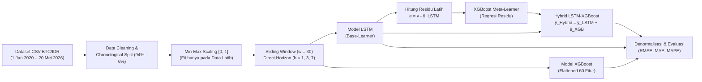
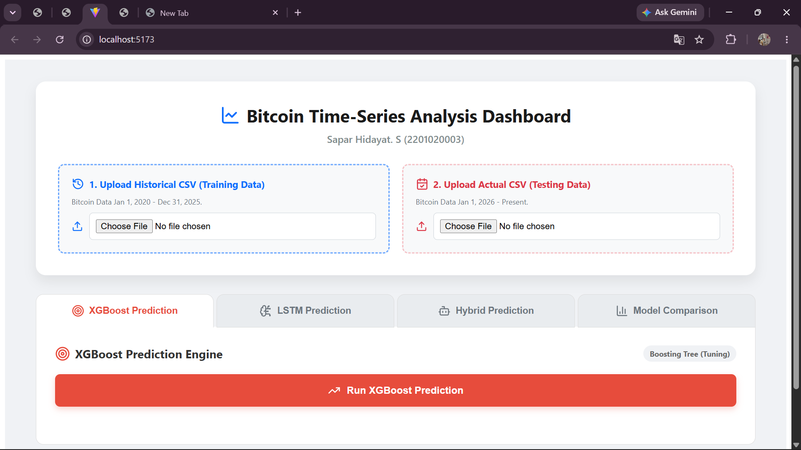
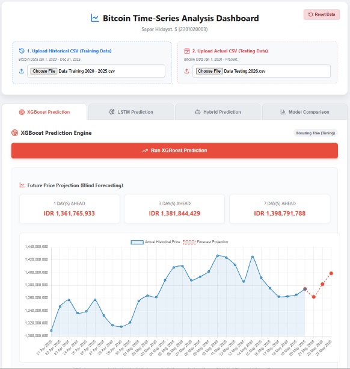
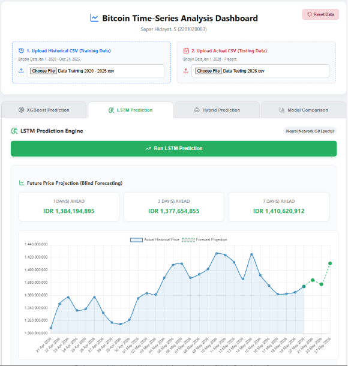
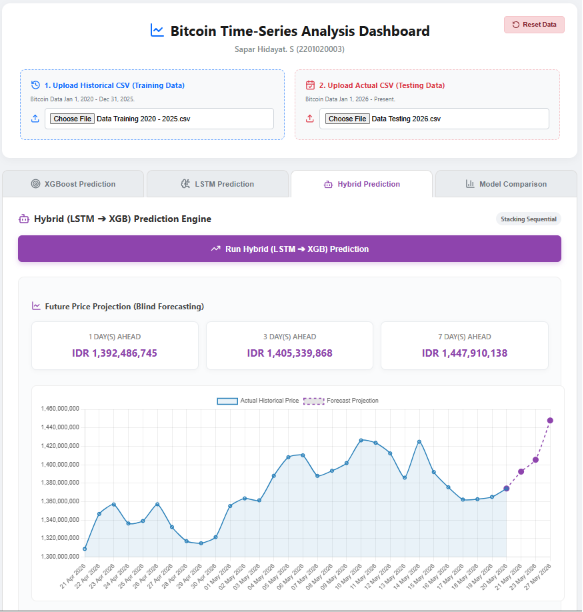
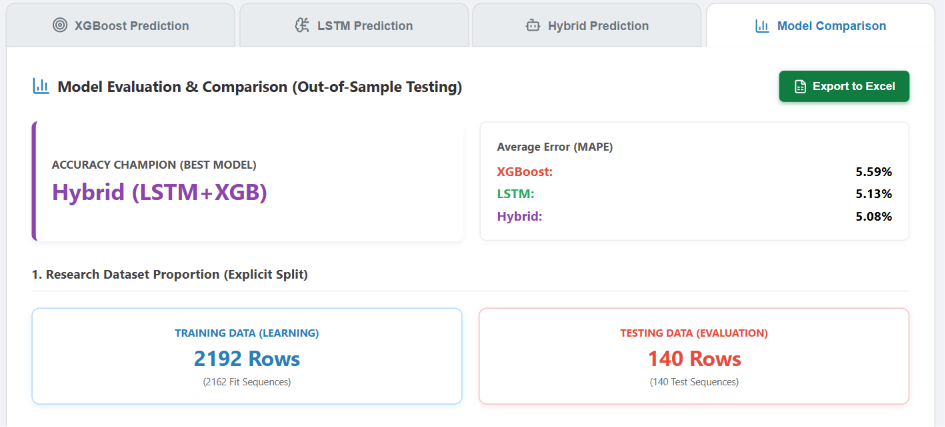

# Comparative Study of LSTM, XGBoost, and Hybrid Models for Bitcoin Price Forecasting

## Working Paper & Tugas Akhir

**Authors:**  
Sapar Hidayat. S, Novrizal Fattah Fahmitra, Tekad Matulatan

**Affiliation:**  
Universitas Maritim Raja Ali Haji (UMRAH), Tanjungpinang, Indonesia  
Program Studi Teknik Informatika, Jurusan Teknik Elektro dan Informatika, Fakultas Teknik dan Teknologi Kemaritiman

**Correspondence:**  
`2201020003@student.umrah.ac.id`

**Year:**  
2026

**Related Documents (di folder [`docs/`](docs/)):**
- **Laporan Tugas Akhir:** [`docs/LAPORAN AKHIR_PUBLIKASI.docx`](docs/LAPORAN%20AKHIR_PUBLIKASI.docx) — *"Studi Komparatif Model LSTM, XGBoost dan Hybrid Model Untuk Peramalan Harga Bitcoin"* (Sapar Hidayat. S, NIM 2201020003).
- **Manuskrip Jurnal (JTIIK):** [`docs/Draft JTI_Bitcoin.docx`](docs/Draft%20JTI_Bitcoin.docx) — *"Comparative Study of LSTM, XGBoost, and Hybrid Models for Bitcoin Price Forecasting"*.
- **Hasil Evaluasi & Prediksi Sistem:** [`docs/Bitcoin_Analysis_Data.xlsx`](docs/Bitcoin_Analysis_Data.xlsx)

---

**Bitcoin Price Forecaster — Hybrid LSTM-XGBoost** adalah Sistem Pendukung Keputusan (*Decision Support System*/DSS) berbasis web (*Bitcoin Time-Series Analysis Dashboard*) untuk **peramalan harga Bitcoin (BTC/IDR)**. Proyek ini mengimplementasikan dan mengevaluasi secara komparatif tiga skema pemodelan deret waktu — **LSTM Tunggal**, **XGBoost Tunggal**, dan **Hybrid LSTM-XGBoost (Residual-Correction Stacking)** — yang dipadukan dengan strategi **Direct Multi-Step Forecasting** pada horizon prediksi 1 hari ($t+1$), 3 hari ($t+3$), dan 7 hari ($t+7$) ke depan.

Seluruh kode sumber, konfigurasi deterministik Docker, pembagian dataset, simulasi perhitungan manual, dan metrik evaluasi pada repositori ini telah diselaraskan 100% dengan laporan tugas akhir dan manuskrip publikasi.

---

## Fitur Utama

- **Komparasi 3 Arsitektur Model** — *Long Short-Term Memory* (LSTM) sebagai *base-learner* sekuensial, *eXtreme Gradient Boosting* (XGBoost) sebagai model *ensemble* pohon keputusan, dan **Hybrid LSTM-XGBoost** dalam satu antarmuka terpadu.
- **Direct Multi-Step Forecasting** — Melatih model independen secara terpisah untuk masing-masing horizon ($h \in \{1, 3, 7\}$ hari) guna mencegah akumulasi kesalahan (*error propagation*) yang lazim terjadi pada metode rekursif.
- **Residual-Correction Hybrid Stacking** — Model LSTM memodelkan tren temporal utama ($\hat{y}_{\text{LSTM}}$), kemudian XGBoost bertindak sebagai *meta-learner* untuk mempelajari pola residu kesalahan ($e_t = y_t - \hat{y}_{\text{LSTM},t}$) sehingga menghasilkan prediksi akhir terkoreksi:
  $$\hat{y}_{\text{Hybrid}} = \hat{y}_{\text{LSTM}} + \hat{e}_{\text{XGBoost}}$$
- **Zero Data Leakage (Chronological Split & Contextual Windowing)** — Parameter normalisasi (`MinMaxScaler`) di-*fit* secara eksklusif pada himpunan Data Latih (2020–2025). Pembentukan sekuens pengujian memanfaatkan ekor data latih sepanjang $\text{WINDOW\_SIZE} + h - 1$ hari (30, 32, dan 36 hari) sehingga evaluasi *out-of-sample* tetap konsisten menghasilkan tepat 140 sekuens uji pada seluruh horizon.
- **Reprodusibilitas Deterministik (Locked Docker Environment)** — Menggunakan image `python:3.10.22-slim`, versi pustaka terkunci (`requirements.lock.txt`), serta konfigurasi deterministik penuh (`PYTHONHASHSEED=42`, `TF_DETERMINISTIC_OPS=1`, `TF_ENABLE_ONEDNN_OPTS=0`, `OMP_NUM_THREADS=1`, `n_jobs=1`) agar hasil pelatihan ulang selalu identik.
- **Blind Forecasting** — Proyeksi harga Bitcoin masa depan pada 21 Mei 2026 ($t+1$), 23 Mei 2026 ($t+3$), dan 27 Mei 2026 ($t+7$) menggunakan 30 observasi historis terakhir.
- **Dashboard Interaktif & Ekspor Laporan** — Visualisasi *Actual vs. Predicted*, *Loss Curve*, analisis residu, ringkasan komparasi model, dan ekspor laporan multi-sheet ke Excel (`.xlsx`).

---

## Arsitektur & Alur Metodologi

### Alur Metodologi Penelitian



### Skema Matematis Hybrid (Residual-Correction Stacking)

```text
1. Prediksi dasar LSTM (skala [0, 1]) :  ŷ_LSTM,t   = LSTM(X_t)
2. Residu pada data latih             :  e_t        = y_t − ŷ_LSTM,t
3. Prediksi residu oleh XGBoost       :  ê_XGB,t    = XGBoost_residual(flatten(X_t))
4. Prediksi akhir Hybrid              :  ŷ_Hybrid,t = ŷ_LSTM,t + ê_XGB,t
5. Denormalisasi ke skala Rupiah      :  Y_asli     = Y_scaled × (X_max − X_min) + X_min
```

### Arsitektur Sistem (Decoupled Web DSS)

```text
React SPA (Vite, Chart.js, Axios) ── POST /api/predict ──► Flask REST API (api.py)
 ├─ Panel unggah CSV Latih & Uji                            ├─ preprocessing.py (clean_bitcoin_data & MinMaxScaler)
 ├─ Visualisasi Tren, Loss & Residu                         ├─ windowing.py (create_sequences, w=30, h∈{1,3,7})
 └─ Tabel Komparasi & Ekspor Excel (SheetJS)                └─ model_utils.py (run_all_models_pipeline)
```

---

## Dataset

- **Sumber Data:** Data historis harian harga Bitcoin dalam Rupiah (BTC/IDR) — CoinMarketCap
- **Rentang Periode:** 1 Januari 2020 – 20 Mei 2026 (2.332 observasi harian)
- **Fitur Masukan:** Harga Buka (`Buka*` / `Open`) dan Harga Tutup (`Tutup**` / `Close`)
- **Target Prediksi:** Harga Tutup (`Tutup**` / `Close`)

| Himpunan Data | Periode | Jumlah Observasi Mentah | Jumlah Sekuens ($w=30$) | Lokasi Berkas |
| :--- | :--- | :---: | :---: | :--- |
| **Data Latih (*Training Set*, 94%)** | 1 Jan 2020 – 31 Des 2025 | 2.192 baris | 2.162 ($h=1$), 2.160 ($h=3$), 2.156 ($h=7$) | [`backend/data/Data Training 2020 - 2025.csv`](backend/data/Data%20Training%202020%20-%202025.csv) |
| **Data Uji (*Testing Set*, 6%)** | 1 Jan 2026 – 20 Mei 2026 | 140 baris | 140 sekuens (pada seluruh horizon) | [`backend/data/Data Testing 2026.csv`](backend/data/Data%20Testing%202026.csv) |
| **Dataset Gabungan** | 1 Jan 2020 – 20 Mei 2026 | 2.332 baris | — | [`backend/data/BTC_2020_2026.csv`](backend/data/BTC_2020_2026.csv) |

---

## Konfigurasi Pemodelan & Hyperparameter

### 1. Konfigurasi Pra-pemrosesan & Eksperimen

| Parameter | Nilai / Spesifikasi |
| :--- | :--- |
| **Fitur Masukan ($X$)** | `[Open, Close]` (2 fitur per langkah waktu) |
| **Variabel Target ($y$)** | `Close` pada langkah waktu $t+h$ |
| **Normalisasi** | `MinMaxScaler(feature_range=(0, 1))`, di-*fit* hanya pada Data Latih |
| **Ukuran Jendela (*Window Size*, $w$)** | 30 hari |
| **Horizon Prediksi ($h$)** | 1 hari ($t+1$), 3 hari ($t+3$), dan 7 hari ($t+7$) — *Direct Multi-Step* |
| **Random Seed / Determinisme** | `seed = 42` (`PYTHONHASHSEED=42`, `tf.keras.utils.set_random_seed(42)`, `enable_op_determinism()`) |

### 2. Spesifikasi Arsitektur & Hyperparameter Model

| Komponen / Parameter | LSTM Tunggal | XGBoost Tunggal | Hybrid LSTM-XGBoost |
| :--- | :--- | :--- | :--- |
| **Struktur Masukan** | Tensor 3D `(N, 30, 2)` | Matriks 2D *flattened* `(N, 60)` | Tensor 3D `(N, 30, 2)` $\rightarrow$ LSTM; Matriks 2D `(N, 60)` $\rightarrow$ XGBoost |
| **Arsitektur Layer** | `LSTM(50, return_sequences=True)` $\rightarrow$ `Dropout(0.2)` $\rightarrow$ `LSTM(50)` $\rightarrow$ `Dropout(0.2)` $\rightarrow$ `Dense(25)` $\rightarrow$ `Dense(1)` | `XGBRegressor(random_state=42, n_jobs=1)` | Base: Arsitektur LSTM yang sama<br/>Meta: `XGBRegressor` pada residu $e_t = y_t - \hat{y}_{\text{LSTM},t}$ |
| **Optimizer & Loss (LSTM)** | `Adam`, `mean_squared_error` (MSE) | — | `Adam`, `mean_squared_error` (MSE) |
| **Batch Size & Validation Split** | `batch_size = 32`, `validation_split = 0.1` (10%) | — | `batch_size = 32`, `validation_split = 0.1` (10%) |
| **Maksimum Epoch & Early Stopping** | `epochs = 30`, `EarlyStopping(monitor='val_loss', patience=3, restore_best_weights=True)` | — | Mengikuti model LSTM pada tiap horizon |
| **Epoch Konvergensi Terbaik** | $h=1$: Epoch 10 (stop di 13)<br/>$h=3$: Epoch 9 (stop di 12)<br/>$h=7$: Epoch 12 (stop di 15) | — | $h=1$: Epoch 10<br/>$h=3$: Epoch 9<br/>$h=7$: Epoch 12 |
| **Optimasi Hyperparameter (XGB)** | — | `RandomizedSearchCV` (`n_iter=5`, `cv=3`, `scoring='neg_mean_absolute_error'`, `random_state=42`, `n_jobs=1`) | `RandomizedSearchCV` (`n_iter=5`, `cv=3`, `scoring='neg_mean_absolute_error'`, `random_state=42`, `n_jobs=1`) |

### 3. Ruang Pencarian Hyperparameter XGBoost (`param_grid`)

| Hyperparameter | Ruang Kandidat | Terbaik (XGBoost Tunggal) | Terbaik (Hybrid Meta-Learner) |
| :--- | :--- | :--- | :--- |
| `n_estimators` | `{100, 200}` | $h=1$: `100`, $h=3$: `100`, $h=7$: `100` | $h=1$: `100`, $h=3$: `100`, $h=7$: `100` |
| `learning_rate` | `{0.05, 0.10}` | $h=1$: `0.05`, $h=3$: `0.05`, $h=7$: `0.05` | $h=1$: `0.05`, $h=3$: `0.05`, $h=7$: `0.05` |
| `max_depth` | `{3, 5}` | $h=1$: `3`, $h=3$: `3`, $h=7$: `3` | $h=1$: `3`, $h=3$: `5`, $h=7$: `3` |
| `subsample` | `{0.8, 1.0}` | $h=1$: `1.0`, $h=3$: `1.0`, $h=7$: `1.0` | $h=1$: `1.0`, $h=3$: `0.8`, $h=7$: `1.0` |
| `colsample_bytree` | `{0.8, 1.0}` | $h=1$: `0.8`, $h=3$: `0.8`, $h=7$: `0.8` | $h=1$: `0.8`, $h=3$: `0.8`, $h=7$: `0.8` |

---

## Hasil Eksperimen & Evaluasi

### 1. Ringkasan Model Terbaik per Horizon (Data Uji 2026)

| Horizon Prediksi | Model Terbaik (berdasarkan MAPE) | MAPE Terbaik | Model Terbaik (berdasarkan RMSE) | RMSE Terbaik (Rp) |
| :---: | :--- | :---: | :--- | :---: |
| **1 Hari ($t+1$)** | **LSTM Tunggal** | **3,64%** (`3,642%`) | **LSTM Tunggal** | **Rp 62.927.546,80** |
| **3 Hari ($t+3$)** | **Hybrid LSTM-XGBoost** | **4,23%** (`4,231%`) | **Hybrid LSTM-XGBoost** | **Rp 73.769.429,09** |
| **7 Hari ($t+7$)** | **LSTM Tunggal** | **6,77%** (`6,765%`) | **Hybrid LSTM-XGBoost** | **Rp 114.341.552,26** |

### 2. Tabel Komparasi Lengkap Metrik Evaluasi Seluruh Model

Nilai terbaik pada masing-masing horizon dicetak **tebal**:

| Horizon | Model | RMSE (Rp) | MAE (Rp) | MAPE (%) | MAPE Presisi (%) |
| :---: | :--- | ---: | ---: | :---: | :---: |
| **1 Hari** | **LSTM** | **62.927.546,80** | **46.816.230,08** | **3,64%** | **3,642%** |
| **1 Hari** | XGBoost | 69.907.347,45 | 47.396.747,95 | 3,89% | 3,894% |
| **1 Hari** | Hybrid LSTM-XGBoost | 69.364.213,38 | 52.384.897,77 | 4,12% | 4,117% |
| **3 Hari** | LSTM | 83.551.924,32 | 64.338.264,89 | 4,99% | 4,994% |
| **3 Hari** | XGBoost | 85.145.091,48 | 64.784.713,23 | 5,23% | 5,226% |
| **3 Hari** | **Hybrid LSTM-XGBoost** | **73.769.429,09** | **53.715.752,18** | **4,23%** | **4,231%** |
| **7 Hari** | LSTM | 116.982.105,43 | **84.757.538,96** | **6,77%** | **6,765%** |
| **7 Hari** | XGBoost | 121.486.314,11 | 95.414.687,71 | 7,66% | 7,661% |
| **7 Hari** | **Hybrid LSTM-XGBoost** | **114.341.552,26** | 86.613.783,86 | 6,90% | 6,899% |

**Temuan Utama:**
1. **Horizon Jangka Pendek (1 Hari):** Model **LSTM Tunggal** unggul dengan MAPE **3,64%** dan RMSE **Rp 62.927.546,80** karena mekanisme gerbang memori sekuensialnya sangat efektif mempertahankan konteks autokorelasi harian jangka dekat.
2. **Horizon Menengah (3 Hari):** Arsitektur **Hybrid LSTM-XGBoost** mencapai akurasi tertinggi di seluruh metrik (MAPE **4,23%**, MAE **Rp 53.715.752,18**, RMSE **Rp 73.769.429,09**), memangkas kesalahan prediksi secara signifikan dibanding LSTM tunggal (4,99%) dan XGBoost tunggal (5,23%).
3. **Horizon Panjang (7 Hari):** Meskipun LSTM unggul tipis pada MAPE (6,77% vs. 6,90%), **Hybrid LSTM-XGBoost** menghasilkan **RMSE terendah (Rp 114.341.552,26)**, membuktikan bahwa mekanisme *Residual-Correction* efektif meredam deviasi kuadrat bernilai besar (*outlier/phase lag*) pada fluktuasi harga jangka panjang.

### 3. Proyeksi Harga Masa Depan (*Blind Forecasting*)

Menggunakan 30 observasi terakhir hingga **20 Mei 2026** (harga penutupan terakhir: **Rp 1.374.193.725,80**):

| Tanggal Proyeksi | Horizon | XGBoost (IDR) | LSTM (IDR) | Hybrid LSTM-XGBoost (IDR) |
| :--- | :---: | ---: | ---: | ---: |
| **21 Mei 2026** | 1 Hari ($t+1$) | Rp 1.361.765.933 | Rp 1.384.194.895 | Rp 1.392.486.899 |
| **23 Mei 2026** | 3 Hari ($t+3$) | Rp 1.381.844.429 | Rp 1.377.654.736 | Rp 1.405.340.050 |
| **27 Mei 2026** | 7 Hari ($t+7$) | Rp 1.398.791.788 | Rp 1.410.620.793 | Rp 1.447.910.098 |

---

## Visualisasi Dashboard

Klik untuk membuka tangkapan layar tiap halaman (berkas dari folder [`docs/`](docs/)):

<details>
<summary>Dashboard Utama</summary>



</details>

<details>
<summary>Model XGBoost</summary>



</details>

<details>
<summary>Model LSTM</summary>



</details>

<details>
<summary>Model Hybrid LSTM-XGBoost</summary>



</details>

<details>
<summary>Evaluasi & Perbandingan Model</summary>



</details>

---

## Struktur Direktori

```text
btc_predictorv2/
├── backend/                          # Flask REST API & Machine Learning Pipeline
│   ├── data/                         # Dataset CSV (Data Training 2020-2025, Data Testing 2026, gabungan)
│   ├── models/                       # Model terlatih (.keras, .json) & scaler.pkl
│   ├── uploads/                      # Penyimpanan sementara CSV yang diunggah via dashboard
│   ├── utils/
│   │   ├── model_utils.py            # Pipeline pelatihan deterministik LSTM, XGBoost, & Hybrid
│   │   ├── preprocessing.py          # Pembersihan format mata uang & MinMaxScaler
│   │   └── windowing.py              # Pembentukan sekuens Sliding Window (Direct Multi-Step)
│   ├── api.py                        # Entry point Flask Server (endpoint POST /api/predict)
│   ├── train.py                      # Script CLI pelatihan & evaluasi seluruh model
│   ├── Dockerfile                    # Konfigurasi container deterministik (python:3.10.22-slim)
│   ├── requirements.txt              # Daftar dependensi utama Python
│   └── requirements.lock.txt         # Lockfile versi eksak seluruh paket Python di container
│
├── docs/                             # Dokumen penelitian, hasil ekspor, & tangkapan layar UI
│   ├── LAPORAN AKHIR_PUBLIKASI.docx  # Laporan Tugas Akhir lengkap (Bab I – Bab V & Lampiran)
│   ├── Draft JTI_Bitcoin.docx        # Manuskrip artikel jurnal (format JTIIK)
│   ├── Bitcoin_Analysis_Data.xlsx    # Hasil ekspor lengkap metrik, blind forecast, & prediksi
│   ├── Eksperimen_Parameter_Log.xlsx # Log eksplorasi hyperparameter awal
│   └── *.png                         # Tangkapan layar visualisasi dashboard
│
├── frontend/                         # Single Page Application (React.js + Vite)
│   ├── src/
│   │   ├── App.jsx                   # Komponen utama dashboard, grafik, & ekspor Excel
│   │   ├── App.css / index.css       # Styling antarmuka
│   │   └── main.jsx                  # Entry point React
│   ├── package.json
│   └── vite.config.js
│
├── Data_Visual.py                    # Script utilitas visualisasi candlestick dataset
├── FlowSystem.md                     # Dokumentasi alur kerja teknis sistem (Frontend -> Backend)
└── README.md                         # Dokumentasi utama & ringkasan working paper
```

---

## Spesifikasi Lingkungan Pengembangan (*Tech Stack*)

Sesuai dengan **Tabel 8** pada Laporan Tugas Akhir:

| Komponen | Teknologi | Versi | Fungsi |
| :--- | :--- | :---: | :--- |
| **Backend & API** | Python, Flask, Flask-CORS | `3.10.22`, `3.0.2`, `4.0.0` | Server komputasi dan REST API (Port `5000`) |
| **Deep Learning** | TensorFlow / Keras | `2.16.1` | Membangun dan melatih jaringan saraf LSTM |
| **Machine Learning** | XGBoost, Scikit-Learn | `2.0.3`, `1.4.1.post1` | *Gradient Boosting*, *RandomizedSearchCV*, dan normalisasi data |
| **Data Processing** | Pandas, NumPy | `2.2.1`, `1.26.4` | Manipulasi deret waktu dan transformasi *sliding window* |
| **Frontend & UI** | React.js, Vite, Axios | `19.2.0`, `7.3.1`, `1.13.6` | Antarmuka SPA dan komunikasi HTTP API (Port `5173`) |
| **Visualisasi** | Chart.js, react-chartjs-2 | `4.5.1`, `5.3.1` | Render grafik tren prediksi, *loss curve*, dan residu interaktif |
| **Ekspor Data** | SheetJS (`xlsx`) | `0.18.5` | Ekspor laporan analisis multi-sheet ke format Excel (`.xlsx`) |
| **Containerization** | Docker (`python:3.10.22-slim`) | — | Isolasi dan reprodusibilitas penuh lingkungan komputasi ML |

---

## Cara Menjalankan Aplikasi

### 1. Menjalankan Backend (Flask API via Docker)

Pastikan **Docker Desktop** sudah berjalan. Gunakan flag `--rm` agar container otomatis dibersihkan saat dihentikan:

```bash
# Jalankan langsung image btc-ai yang sudah ter-build
docker run --rm -p 5000:5000 btc-ai
```

Jika Anda melakukan perubahan pada kode di folder `backend/` dan ingin melakukan *build* ulang dengan versi paket yang sudah dikunci (`requirements.lock.txt`):

```bash
cd backend
docker build -t btc-ai .
docker run --rm -p 5000:5000 btc-ai
```

Backend akan aktif di `http://localhost:5000`.

### 2. Menjalankan Frontend (React Dashboard)

Buka terminal baru dan jalankan perintah berikut:

```bash
cd frontend
npm install
npm run dev
```

Akses dashboard melalui browser di `http://localhost:5173`.

### 3. Langkah Penggunaan Dashboard

1. Unggah berkas **`Data Training 2020 - 2025.csv`** dan **`Data Testing 2026.csv`** (tersedia di folder `backend/data/`) pada panel unggahan.
2. Pilih algoritma pada sidebar (**XGBoost**, **LSTM**, atau **Hybrid**) lalu klik **Run Prediction** untuk menjalankan pemodelan serta menampilkan proyeksi 1, 3, dan 7 hari ke depan beserta grafik analisisnya.
3. Buka menu **Model Comparison** untuk melihat tabel komparasi metrik evaluasi (**RMSE**, **MAE**, **MAPE**) secara berdampingan dan klik **Export to Excel** untuk mengunduh laporan lengkap.

---

## Penulis

**Sapar Hidayat. S** — NIM 2201020003  
Program Studi Teknik Informatika  
Jurusan Teknik Elektro dan Informatika  
Fakultas Teknik dan Teknologi Kemaritiman  
Universitas Maritim Raja Ali Haji (UMRAH), Tanjungpinang  

**Dosen Pembimbing:**
1. **Novrizal Fattah Fahmitra, M.Kom.** (Pembimbing Utama)
2. **Tekad Matulatan, S.Kom., M.Info., Tech.** (Pembimbing Pendamping)

---

© 2026 Sapar Hidayat. S, Novrizal Fattah Fahmitra, Tekad Matulatan — Universitas Maritim Raja Ali Haji.
